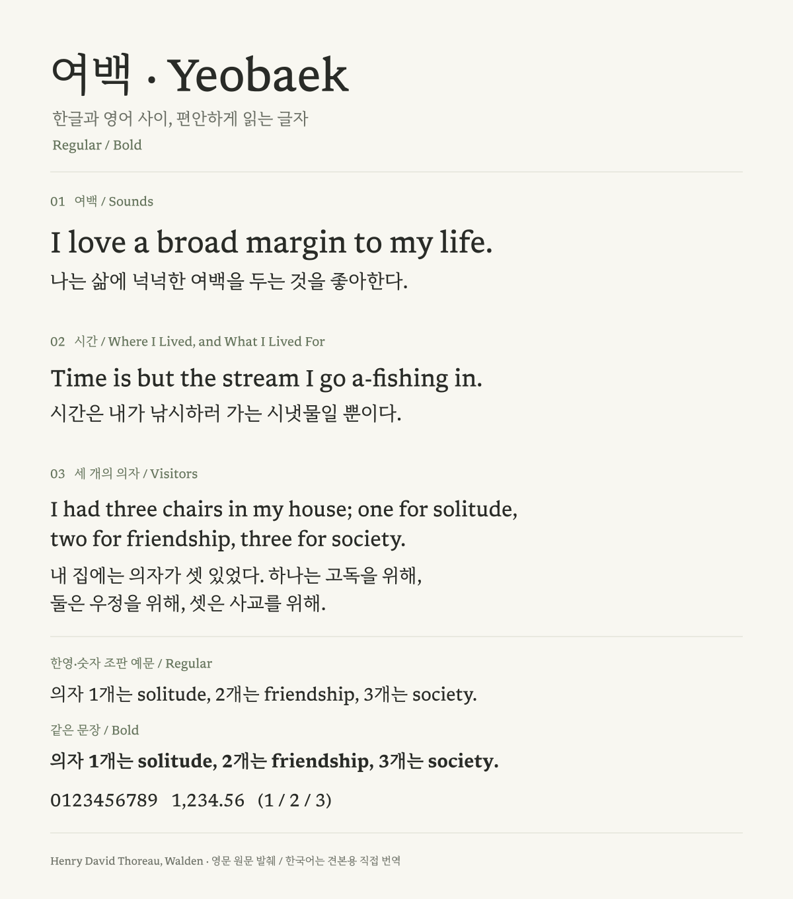

# 여백 · Yeobaek

한글은 **리디바탕**, 영문과 숫자는 **Libron**을 사용하는 독서용 합성 서체입니다.
Regular와 별도의 Bold TTF를 만듭니다. 이 저장소에는 빌드 코드와 라이선스가
들어 있으며, 원본 폰트와 생성된 바이너리는 포함하지 않습니다.

**설치용 폰트:** [최신 릴리스](https://github.com/gerald-kim/yeobaek/releases/latest)에서
ZIP을 받아 Regular와 Bold TTF를 함께 설치하세요. 직접 빌드하려면 아래 절차를 따르세요.



영문은 헨리 데이비드 소로의 [『월든』 원문](https://www.gutenberg.org/files/205/205-h/205-h.htm)에서
골랐습니다. 한국어는 견본용으로 직접 번역했으며, 아래의 한영·숫자 혼합 문장은
‘세 개의 의자’ 대목을 바탕으로 만든 조판 예문입니다. 이미지는 v0.004 TTF의 실제
윤곽선으로 렌더링했습니다.

Yeobaek combines RIDIBatang Korean with Libron Latin and digits for mixed-language
reading. This is an experimental derivative, not an official RIDI, Sandoll or
Libron release. Both faces use the family name **Yeobaek** (Korean: **여백**).

## 구성

| 항목 | 처리 |
| --- | --- |
| 영문·숫자·Libron에 있는 문자 | Libron v0.32 Regular / 실제 Bold |
| 나머지 문자 | RIDIBatang 1.0.1 |
| 영문 수직 위치 | 한글과 어울리도록 0.07em 아래로 이동 |
| 한글 Bold | 원본 윤곽선의 획 두께를 0.020em 늘림 |
| 출력 | `Yeobaek-Regular.ttf`, `Yeobaek-Bold.ttf` |
| 스타일 연결 | 같은 가족 이름, Regular 400 / Bold 700, 일치하는 행간 |
| 문자 범위 | 기준 입력에서 12,905개 코드 포인트, 현대 한글 11,172자 포함 |

TTF는 Libron의 배포 형식을 유지하기 위해 선택했습니다. OTF가 더 높은 품질이라는
뜻은 아닙니다. Regular 한글은 FontForge로 CFF에서 TrueType으로 변환하고,
Bold 한글은 Skia로 원본과 확장 획을 합쳐 겹침을 정리한 뒤 TrueType으로 변환합니다.
한글의 가로 진행 폭은 보존합니다. 영문 커닝과 합자 테이블도 유지합니다.

## 빌드

Linux와 Docker가 있는 환경을 기준으로 합니다. 빌드 도구는 Libron 제작자의
`fntbld-oci` 이미지 digest로 고정했습니다. 이미지가 없으면 Docker가 내려받으며,
컨테이너 안의 빌드는 네트워크 없이 실행됩니다. 시스템에 폰트를 설치하지 않습니다.

1. [Libron v0.32 릴리스](https://github.com/nicoverbruggen/libron/releases/tag/v0.32)의
   `Libron.zip`을 받아 별도 폴더에 풉니다. Regular와 Bold TTF가 필요합니다.
2. [리디 공식 배포 페이지](https://ridicorp.com/ridibatang/)에서 RIDIBatang OTF를
   준비합니다. 기준 파일은 1.0.1이며, 해시는 [sources.json](sources.json)에 있습니다.
3. 아직 존재하지 않는 출력 디렉터리를 지정합니다.

```sh
./build.sh /path/to/RIDIBatang.otf /path/to/libron /path/to/output/yeobaek
```

입력 해시가 다르면 빌드를 중단합니다. 기준 리디바탕 파일은 기존에 설치된 원본
OTF에서 확보했습니다. 준비 당시 공식 다운로드가 HTTP 403을 반환했으므로,
지금 다운로드할 수 있다고 보장하지 않습니다. 출처 불명의 파일로 해시만 바꾸지
말고, 다른 원본 버전을 쓰려면 출처와 결과를 다시 검증해야 합니다.

출력에는 두 TTF, `OFL.txt`, 입력 정보, 빌드·검증 보고서, `specimen.html`이 포함됩니다.
두 TTF를 함께 설치하거나 리더 앱에 가져오세요. `specimen.html`은 가상 굵게를
금지하고 별도 Bold 파일을 지정한 비교 페이지입니다.

README 견본은 같은 빌드 환경에서 다음과 같이 재생성할 수 있습니다.
출력 파일은 새 경로를 지정해야 합니다.

```sh
python3 specimen.py /path/to/output/yeobaek /path/to/new-specimen.svg
```

## 검증과 한계

빌드 후 `verify.py`가 다음을 확인합니다.

- 현대 한글 11,172자에 실제 윤곽선이 있고 두 굵기의 가로 진행 폭이 같은지
- 영문 윤곽선이 원본에서 0.07em만 내려갔는지 (합성 글리프 반올림 오차 0.5 unit 이내)
- HarfBuzz의 커닝·합자·결합 악센트 표본 결과가 원본 Libron과 같은지
- 한영 혼합 및 분해된 한글 표본에 누락 글리프가 없는지
- 한글·영문 가족 이름, 굵기 플래그와 두 파일의 행간이 일치하는지

로컬에서 Fontconfig의 Regular/Bold 선택과 20px 한글 전체 렌더링도 확인했습니다.
실제 전자책 기기나 모든 앱에서의 동작을 보장하는 검증은 아닙니다.

**한글 Bold는 새로 설계한 글꼴이 아니라 기계적으로 가공한 파생본입니다.**
복잡한 받침과 쌍자음은 작은 크기에서 뭉칠 수 있습니다. 세로쓰기용 테이블은
보존하지 않으며, 전체 문자에 대한 광학적 완성도를 보증하지 않습니다.

고정된 컨테이너와 입력 해시로 같은 과정을 재현합니다. 폰트 타임스탬프 등의 영향으로
산출물의 바이트 단위 재현성까지 보장하지는 않습니다.

## 라이선스와 출처

빌드 코드와 파생 폰트는 **SIL Open Font License 1.1**로 배포합니다.
[LICENSE](LICENSE)에 원본 저작권 안내와 라이선스 전문이 있습니다.
수정·병합·재배포가 가능하지만, 폰트 자체만 유료로 판매할 수 없으며 재배포 시
저작권 안내와 OFL 조건을 보존해야 합니다. 폰트로 만든 문서에는 OFL이 전파되지 않습니다.

- [RIDIBatang](https://ridicorp.com/ridibatang/): RIDI / Sandoll.
- [Libron](https://github.com/nicoverbruggen/libron): Nico Verbruggen.
- Libron의 기반인 [Readerly](https://github.com/nicoverbruggen/readerly)와
  [Newsreader](https://github.com/productiontype/Newsreader)의 저작권 안내도 보존합니다.
- `Libron`은 예약된 폰트 이름이므로 파생본은 별도 이름인 `Yeobaek`을 사용합니다.

빌더는 Libron 작업 트리의 실험 코드에서 분리했습니다. 기반 소스 커밋:
`aa1bf957f88629b1232bcdb2da02f199f1fb0a21`.
폰트 입력은 위 커밋의 미빌드 소스가 아닌 **v0.32 릴리스 TTF**입니다.
